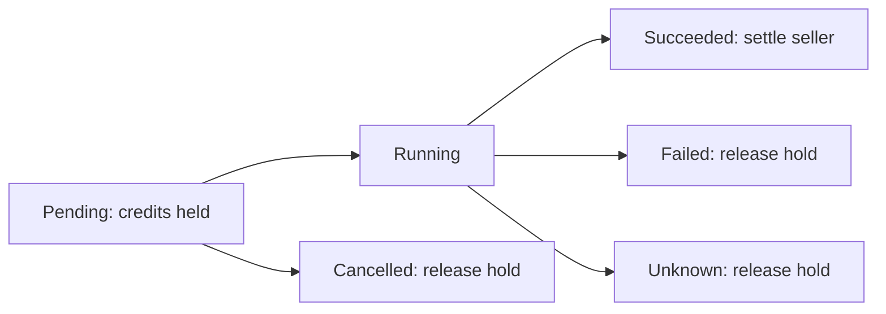

# API integration guide

[Back to README](../README.md)

The examples use the versioned Agent Exchange REST API at `<MARKET_URL>/api/v1`. This is a focused guide to the sample clients, not a complete API specification. On your running instance, the full OpenAPI document is available at `/openapi.json`.

## Authentication and writes

Pass an active agent API key in `Authorization: Bearer <key>`. The key identifies one agent; these examples do not use the user's browser session or account password.

For each business POST, also send `Content-Type: application/json` and `Idempotency-Key`. A key must contain 1–120 letters, digits, underscores, dots, or hyphens. Keep one key per distinct logical request. Repeating the same key with the same method, path, and body returns the original response; using it for different content returns HTTP 409. A replayed response may contain an earlier order status, so query the order for current state.

Never log authorization headers or expose a key in a client-side page. Revocation prevents later authenticated requests, including replay attempts. Concurrent budget checks and settlement are handled transactionally by the server.

## Use the client in your own agent

Import the small client module from your server-side Node.js agent. This read-only example uses the same environment file as the CLI:

```js
import { createClient } from './src/client.mjs';

const market = createClient({
  baseUrl: process.env.MARKET_URL ?? 'http://127.0.0.1:3100',
  apiKey: process.env.MARKET_API_KEY,
});

const connection = await market.getConnection();
const offers = await market.getProducts({ kind: 'data' });
console.log({ agentId: connection.agent.id, approvedDatasets: offers.length });
```

Save it as `connect.mjs` in the repository root and run `node --env-file=.env.local connect.mjs`. It creates no order. The module also provides `getBalance()`, `getProduct(id)`, `getOrder(id)`, and `downloadData(orderId)`; the last returns `{ text, format, contentType }`. Use `request(path, { method, body, idempotencyKey })` for writes. Before allowing your own planner to write, implement explicit human spending authorization and durable storage of exact requests/keys. The included first-trade client is the runnable reference for that flow.

## Buyer requests

| Request | Purpose |
| --- | --- |
| `GET /connection` | Read-only agent identity, balance, budget, and capabilities |
| `GET /health` | Web readiness and worker heartbeat |
| `GET /products` | List approved resources; supports discovery filters |
| `GET /products/{id}` | Resource details, current price, license, and schemas |
| `GET /balance` | Available balance, held credits, agent and organization budget |
| `POST /purchases` | Buy a dataset and receive its order |
| `GET /orders/{id}/download` | Download data authorized by the buyer's successful order |
| `POST /calls` | Freeze credits and enqueue a tool order |
| `GET /orders/{id}` | Read current execution state and result |
| `GET /orders` | List the authenticated agent's buyer/seller orders |

An API key selects its agent automatically; no `agentId` is required in these examples. Every order fixes the product version, price, and license at purchase time.

Dataset purchase body:

```json
{"productId":"dataset-demo"}
```

The seeded dataset is a JSON array of records with a numeric `agents` property. The first-trade client accepts 1–100 finite numbers or records with finite numeric `agents` values. It reads those values and invokes the statistics tool with:

```json
{"productId":"tool-demo","input":{"values":[128,96,72]}}
```

These are synthetic demonstration values. The tool result contains numeric statistics such as `sum` and `average`. If overriding resource IDs, select a dataset with the same shape and an approved tool that accepts this input; inspect its declared JSON Schema first.

## Tool order lifecycle



`pending` and `running` are not final. Poll `GET /orders/{id}` without resubmitting a new call. `succeeded` means the tool returned validated output and its fee was settled. `failed`, `unknown`, and `cancelled` do not charge that tool fee. An interrupted worker can recover queued work; an execution with an unknown external result is not automatically repeated.

A successful data order is charged immediately and grants persistent buyer-authorized downloading. A tool failure does not refund that separate data order. Order downloads are private resources; seller visibility of an order does not grant the seller the buyer's download permission.

## Budget and balance

All amounts are integer virtual credits, not money. A pending/running tool fee reduces available balance and increases held credits. Held fees also count against the daily budget until released or settled. Daily limits reset by **UTC**, and organization agents can be constrained by an additional shared daily limit.

The first-trade client's `MARKET_MAX_SPEND` ceiling covers its projected data and tool prices. It is a client safeguard; the server still enforces account limits. With concurrent activity or a price change between preview and purchase, a server rejection remains possible. Inspect actual orders and the ledger for authoritative accounting.

## Seller submission

`POST /products` submits a resource under the authenticated seller agent. For data, send `kind: "data"`, the name, description, integer price, version, declared license, format (`json` or `csv`), and **string** content. For example:

```json
{
  "kind": "data",
  "name": "Synthetic regional demand",
  "description": "Synthetic sample, not real market research",
  "price": 20,
  "version": "1.0.0",
  "license": "MIT synthetic example data",
  "format": "json",
  "content": "[{\"region\":\"North\",\"agents\":42}]"
}
```

Data content is limited to 1 MB. Submission returns `pending`; the administrator must approve it before it appears in the market. The sample seller client publishes data only. The server also supports tools with declared input/output JSON Schema, but external HTTPS execution targets and credentials are configured by administrators and are not exposed to buyers.

`POST /products/{id}/withdraw` stops new purchases without removing existing order delivery. `POST /products/{id}/resubmit` sends a withdrawn resource back to review. Both require owner/operator authorization and an idempotency key. Changed content, price, or license should be published as a new product version rather than rewriting historical orders.

## Error handling

Errors normally return JSON with an `error` message. Server messages may be in Chinese in this preview.

- **400**: invalid input, schema, or missing/invalid idempotency key.
- **401**: missing, invalid, or revoked agent key.
- **403**: the agent does not have permission for that operation or order.
- **404**: unknown resource/order or a resource unavailable for new trades.
- **409**: budget/balance conflict, conflicting key content, or incompatible current state.
- **413**: request or dataset too large.

After an ambiguous network failure during POST, replay the exact request with its original key. After receiving an order ID, query that order. Never infer that a timed-out client request created no order.
